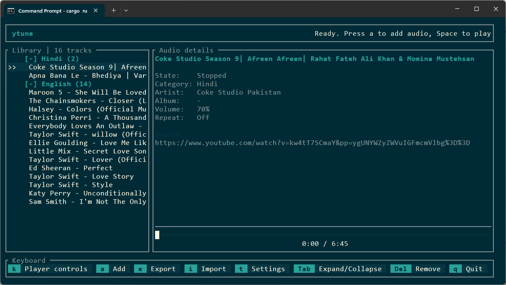

# ytune

A keyboard-driven YouTube audio player built with Rust and Ratatui. The narrow left
pane groups saved video URLs by playlist/category; the right pane displays the
current title, available artist/album metadata, source URL, seek bar, volume,
and repeat mode. Status and errors appear in the top-right header. Keyboard
shortcuts stay at the bottom as badges with cyan keys and dark-gray actions,
wrapping to fit the terminal without splitting key/action pairs.
The **Up/Down**, **Space**, **n/b**, **Left/Right**, **+/-**, **r**, **m**, and **s** controls
are shown in two columns and four rows, with a blank line between rows, in a centered dialog:
press **k** to open it, and **k** or **Esc** to close it.
These playback controls remain usable while the dialog is
open, including track selection and volume changes; other library/settings
controls require closing it first. **q** still quits.
The playing track is bold green (yellow while paused), even when another
track is selected.
Playback progress uses a thin seek track with a rectangular playhead. Elapsed and
total time are displayed below the track, so the playhead never covers them.
Use Left/Right to seek by the configured interval.

## Screenshot



## Requirements

- Current stable Rust (edition 2024; tested with Rust 1.93)
- [mpv](https://mpv.io/installation/) with its standard yt-dlp hook
- A current [yt-dlp](https://github.com/yt-dlp/yt-dlp#installation) executable
- A [yt-dlp-supported JavaScript runtime](https://github.com/yt-dlp/yt-dlp/wiki/EJS)
  (Deno is enabled by default), recommended for full YouTube format support
- Internet access and an audio output device
- A terminal at least 64 columns by 20 rows

Install mpv and yt-dlp using your preferred package manager, for example on
Windows, for yt-dlp:

```powershell
winget install --id yt-dlp.yt-dlp -e
```

Use a package that exposes **mpv itself**, not just a GUI launcher, on PATH.
Alternatively install mpv from its installation page and set `YTUNE_MPV`.
Both `mpv --version` and `yt-dlp --version` should work in your shell.
Paths containing spaces are supported:

```powershell
$env:YTUNE_MPV = 'C:\tools\mpv\mpv.exe'
$env:YTUNE_YTDLP = 'C:\tools\yt-dlp.exe'
cargo run --release
```

On Linux/macOS, install mpv and yt-dlp with your package manager, then run
`cargo run --release`. Playback uses a local named pipe on Windows and a Unix
socket on Unix. Only the mpv child started by ytune is stopped on exit.

## Usage

1. Run `cargo run --release`.
2. Press **a**, paste a YouTube video URL, and use **Tab** to edit its category
   and optional display-title override. Press **Enter** to resolve the video's
   title and metadata and save it. The UI stays responsive during lookup;
   **Esc** cancels without adding the track.
3. Select a track and press **Space** to stream its audio.

Playback selections (**Space**, **n**, and **b**) wait 400 ms before resolving
YouTube audio and metadata. Rapid changes reset this delay, so only the final
track starts a network lookup. The list and saved details update immediately;
the previous audio may continue briefly until the new track starts loading.
**s** cancels a pending selection. Automatic queue progression does not wait.

Use a normal video, Shorts, live-video, or `youtu.be` URL. A video URL containing
a playlist parameter plays that video only. Playlist-only URLs are not
imported: create a named category and add its videos individually.
The queue follows the displayed category/track order, across categories.
New tracks store the resolved source title, artist, album, uploader, duration,
thumbnail URL, and upload date when available. An optional custom display title
overrides the resolved title in the list without discarding the source title.
Saved metadata is available in the details pane before playback. Existing
tracks remain compatible but are not automatically backfilled.

Select a category header with **Up/Down** and press **Tab** or **Space** to
collapse/expand it. **Tab** also works while one of its tracks is selected.
`[+]` indicates a collapsed category and `[-]` an expanded one. Hidden tracks
remain in the playback queue; next/previous and repeat still traverse the
entire library. Collapse state lasts for the current session.

| Key | Action |
| --- | --- |
| Up / Down (or j for down) | Select previous / next visible track or category |
| k | Open / close the player shortcuts dialog |
| Home / End | Select first / last visible row |
| Space | Play/pause selected track; toggle selected category |
| Tab | Expand / collapse the selected category |
| n / b | Play next / previous track (wrap around) |
| r | Cycle repeat: Off, Track, All |
| Left / Right | Seek backward / forward by the configured interval (default 10 seconds) |
| + / - | Adjust volume by the configured step (default 5%; volume stays within 0–100%) |
| a | Add a URL to a new or existing category |
| m | Toggle mute / unmute without changing the volume level |
| e | Export the entire library as JSON |
| i | Import and merge a saved JSON playlist/library |
| t | Open Settings |
| s | Stop audio and reset playback position |
| Delete | Ask to remove the selected track; y confirms, n / Esc cancels |
| q | Quit (main view) |

In the add dialog, **Tab / Shift+Tab** changes fields, **Ctrl+U** clears a
field, **Backspace** deletes the last character, **Enter** resolves metadata
and saves, and **Esc** cancels. Text is appended at the end of the active field.
Fields are locked while metadata is resolving. Failed lookups or saves leave
the dialog open with an error and do not add a partial track. Lookup times out
after 60 seconds; fix the problem and press Enter to retry.

Escape only dismisses dialogs; it does nothing in the main view. Ctrl+C does
not quit. In text-entry dialogs, `q` is ordinary text; close the dialog with
Escape before pressing `q` to quit.

Deleting a song shows a padded confirmation dialog with its title and category,
and side-by-side **Yes, delete** and **No, keep** options.
Only **y** deletes it; **n** or **Esc** keeps it. Playback is stopped only if
the confirmed song is currently playing and the playlist was saved successfully.
Save failures stay visible in the dialog so you can retry or cancel.

## Export

Press **e** to export every category and track, including saved metadata, to a
JSON file. The default destination is `ytune-playlists.json` in the configured
data folder. Edit the destination path or use **Ctrl+U** to clear it, then press
**Enter** to export. **Esc** cancels. Parent directories are created if needed.
Existing files are never overwritten; choose a different path if one exists.
Exports use the same JSON structure as the saved library. Exporting does not
modify the library or require a network connection.

Automatic playback stops at the end with repeat Off, replays the current track
with repeat Track, and wraps the whole library with repeat All. Playback errors
are displayed rather than silently skipping videos; select a track and press
Space to retry. Seeking may not be available for live streams.
Recoverable mpv probe errors and cancelled extraction subprocesses are not shown
as playback failures. If playback actually fails, the error includes mpv's most
recent diagnostic.
Press **s** to stop playback without closing the engine or changing mute or
volume. **Space** starts the selected track again from the beginning.

## Import

Press **i**, type or paste the path to a JSON file produced by Export (or an
existing `library.json`), then press **Enter**. **Ctrl+U** clears the path and
**Esc** cancels. Relative paths are resolved from the working directory.

Import merges into the current library rather than replacing it:

- Categories with matching names are combined; new categories are appended.
- Duplicate URLs within the same category are skipped, including duplicates
  inside the imported file. Existing titles and metadata are kept unchanged.
  The same URL can still appear in different categories.
- New tracks retain their saved metadata. Older files without metadata are
  supported; importing does not perform network lookups or backfill metadata.
- Existing track order is preserved, with imported tracks appended to their
  categories. Empty categories in the source are ignored.
- Playback, selection, and collapsed categories are preserved.

The entire file is validated before the merged library is saved atomically.
Malformed JSON, unsupported video URLs, invalid metadata, read errors, or save
errors leave the existing library unchanged and keep the dialog open with an
error. Successful imports report the numbers of added and skipped tracks.
The source file is never modified. Import works without mpv or yt-dlp; dismiss
the missing-dependency dialog first if it is displayed.

## Settings

Press **t** to open a centered Settings overlay above the library and audio
details. Use **Tab / Shift+Tab** or
**Up / Down** to select a field, **Ctrl+U** to clear it, **Backspace** to remove
the last character, **Enter** to save, and **Esc** to return without saving.
Each setting is shown as a label on the left and a bordered value text box on
the right. The active text box has a cyan border and a highlighted background.
Text is appended at the end of the active field.

- **yt-dlp executable:** shows the resolved executable path when available.
  Enter a valid executable path, including paths containing spaces. A saved
  path takes precedence over `YTUNE_YTDLP` and PATH. Clear the field to return
  to automatic discovery (`YTUNE_YTDLP`, then PATH). Saving a changed path
  restarts the playback engine and stops current playback. Saving while the
  engine is Not Ready also retries startup. The same executable is used for
  metadata lookup and streaming.
- **mpv executable:** shows the resolved executable path when available.
  Enter the path to mpv itself (for example, `C:\tools\mpv\mpv.exe`), not a GUI
  launcher. Paths containing spaces are supported. A saved path takes precedence
  over `YTUNE_MPV` and PATH. Clear the field to return to automatic discovery
  (`YTUNE_MPV`, then PATH). Saving a changed path stops current playback and
  restarts the playback engine. Saving while the engine is Not Ready retries startup.
- **Seek interval:** a positive whole number of seconds; default **10**.
- **Volume step:** a whole-number percentage from **1** to **100**; default **5**.
  Seek and volume changes take effect immediately without restarting playback.
- **Data folder:** the folder used for `library.json`, `settings.json`, and the
  default export destination. Relative paths become absolute when saved.

Changing the data folder copies the current library and the new settings to
the destination and switches future reads/writes there. Old files are kept.
To protect existing data, another folder already containing `library.json` or
`settings.json` is refused; choose a new folder or import its library instead.
If the switch fails, the original location remains active. A small
`location.json` locator stays in the original platform configuration directory
so the app can find the chosen folder on the next launch.

Settings are saved atomically. Invalid values or write errors leave the dialog
open with an error and preserve the active configuration. Missing settings
files in the default configuration folder use the original 10-second/5%
defaults. Invalid saved settings or missing relocated data are reported at
startup rather than silently resetting the library.

Example `settings.json`:

```json
{
  "ytdlp_path": "C:\\tools\\yt-dlp.exe",
  "mpv_path": "C:\\tools\\mpv\\mpv.exe",
  "seek_seconds": 10,
  "volume_step": 5
}
```

## Saved library

Changes are saved immediately and atomically to `library.json` in the
configured data folder. Before changing Settings, the default is:

- Windows: `%APPDATA%\ytune\ytune\config\library.json`
- Linux: `~/.config/ytune/library.json`
- macOS: `~/Library/Application Support/com.ytune.ytune/library.json`

Example:

```json
{
  "playlists": [
    {
      "name": "Favorites",
      "tracks": [
        {
          "title": "My saved video",
          "url": "https://www.youtube.com/watch?v=VIDEO_ID",
          "metadata": {
            "title": "Resolved video title",
            "artist": null,
            "album": null,
            "uploader": "Example channel",
            "duration": 120.0,
            "thumbnail": null,
            "upload_date": "20261018"
          }
        }
      ]
    }
  ]
}
```

Malformed or unreadable libraries cause an explicit startup error and are not
overwritten. Failed saves leave the in-memory library unchanged.

## Troubleshooting and development

If yt-dlp cannot be found at its saved path, on PATH, or at `YTUNE_YTDLP`, a centered error dialog
shows setup instructions. The top-right header displays **Not Ready** in
yellow whenever the playback engine is unavailable. Press **Esc** to dismiss
the dialog, **t** to set its path in Settings, or **q** to quit; dismissing it
does not mark the engine ready.
Other errors continue to appear in the header.
Navigation, removal, import, and export still work without playback dependencies, but adding a new track
requires yt-dlp and a successful metadata lookup. Install the dependency (or
set its path in Settings or its environment override), then save Settings to
retry startup or restart the app.
Update yt-dlp when YouTube changes its extraction behavior. Restricted,
private, unavailable, or sign-in-required videos may not play. No credentials
or cookies are configured by ytune. mpv user configuration is disabled for
predictable audio-only behavior. Use only content you are authorized to access
and respect YouTube's terms.

```powershell
cargo test
cargo clippy --all-targets -- -D warnings
cargo build --release
```

An opt-in integration test exercises a real mpv process with a generated silent
WAV (load, pause, seek, volume, resume, end-of-file). It requires the playback
dependencies and an audio device. Set `YTUNE_SMOKE_URL` to a YouTube video URL
to additionally verify network streaming and advancing playback:

```powershell
cargo test real_mpv_playback_smoke_test -- --ignored --nocapture
```

To verify next/previous/next during real lookups does not leave a stale
cancellation or probe error while the final track streams, set `YTUNE_SMOKE_URL`
and run:

```powershell
cargo test real_track_switch_keeps_playback_error_free -- --ignored --nocapture
```

To verify adding a real YouTube video, persisting its resolved metadata,
exporting it, and cancelling a subsequent lookup:

```powershell
$env:YTUNE_SMOKE_URL = 'https://www.youtube.com/watch?v=jNQXAC9IVRw'
cargo test real_add_resolves_and_persists_metadata -- --ignored --nocapture
```
